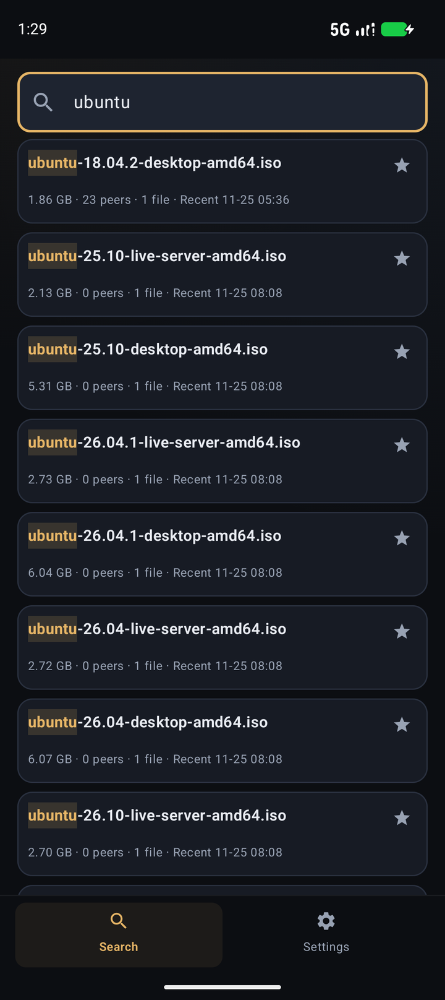

  

<h1 align="center">Magnet Search</h1>

<strong>Lightweight, offline magnet search for Android.</strong>

  <a href="https://github.com/mtsrch/mtsrch.github.io/releases/latest"><b>Download the latest APK</b></a>
  &nbsp;·&nbsp;
  <a href="https://mtsrch.github.io/">Website</a>
  &nbsp;·&nbsp;
  <a href="https://mtsrch.github.io/home/privacy/">Privacy policy</a>

  

## What is Magnet Search?

Magnet Search is a free Android app for searching a magnet index without sending your queries to a search service. The index is bundled inside the APK, so search works entirely offline, including in airplane mode.

The app requires no account. It contains no analytics or crash-reporting SDK.

## Features

- Search the bundled magnet index by name, tag, file extension, or sort order.
- View file lists, first-seen and last-seen timestamps, and copy magnet links or infohashes.
- Save favorites and recent searches locally on your device.
- Chinese and English interface.
- No account, no cloud sync, and no Google Play Services required.
- Android 8.0 and later; package name `io.github.mtsrch`.

## Download

| Source | Link |
| --- | --- |
| Latest signed APK | [GitHub Releases](https://github.com/mtsrch/mtsrch.github.io/releases/latest) |
| Download page | [mtsrch.github.io](https://mtsrch.github.io/) |
| In-app update manifest | [update.json](https://mtsrch.github.io/update.json) |

Each GitHub release is tagged `magnet-v<version>` and includes:

- `mtsrch-magnet-<version>-release.apk` — signed release APK
- `mtsrch-magnet-<version>-release.apk.sha256` — SHA-256 checksum

## Install

1. Download the latest APK from the releases page or the website.
2. Open the APK on your Android device.
3. If Android asks, allow installs from your browser or file manager for this one-time install.
4. Complete the installation. You can turn the permission off again afterwards.

The GitHub build includes an in-app updater. It checks `update.json`, downloads the next signed APK, verifies its size and SHA-256, and opens the system installer. Android may ask you to allow this app to install updates; that permission is used only for its own updates.

## Privacy

- No account, name, email address, phone number, location, or device identifier is requested.
- Favorites, search history, and language preference stay in the app's private storage.
- Search terms are used only for local database queries and are not sent to a server.
- Network access is used only to check for and download app updates.
- No analytics or crash-reporting SDK is included.

Read the full [privacy policy](https://mtsrch.github.io/home/privacy/).

## About this repository

This repository hosts the official website and signed release APKs for Magnet Search. The Android source code is not part of this repository.

## Links

- Website: https://mtsrch.github.io/
- Releases: https://github.com/mtsrch/mtsrch.github.io/releases
- Privacy policy: https://mtsrch.github.io/home/privacy/
- Issues and feedback: https://github.com/mtsrch/mtsrch.github.io/issues

---

© 2026 Magnet Search · mtsrch
